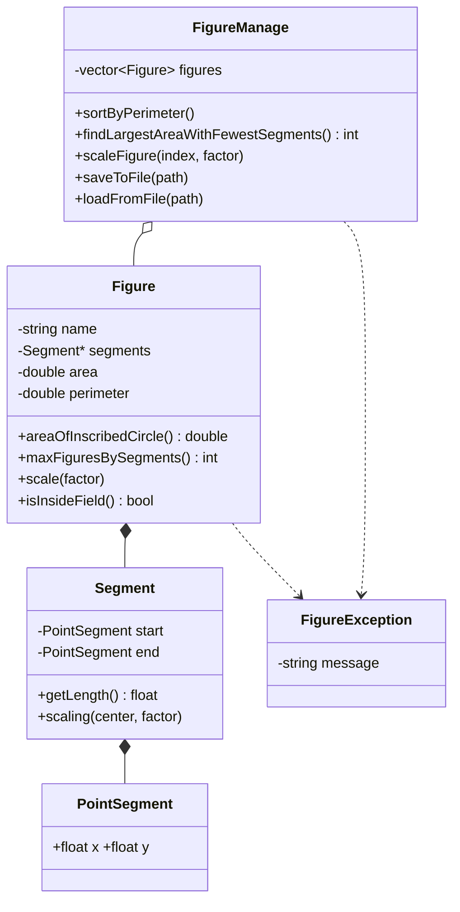

# 📐 Figure Builder — Plane Figures from Segments (C++/CLI, Windows Forms)

<p align="center">
  
  
  
  
  
</p>

<p align="center">
  
</p>

---

## 📖 Overview

A desktop application that builds closed plane figures from segment coordinates, draws them on a 715 × 715 field and calculates their properties. Figures can be entered manually or loaded from a text file.

It was written as an Object-Oriented Programming coursework project. The domain logic (`Segment`, `Figure`, `FigureManage`, `FigureException`) is plain standard C++ and does not depend on the GUI; only the window classes use .NET.

> The interface is in Ukrainian. Button names are given below as *English (Ukrainian label)*.

---

## ✨ Features

- Create a figure from 3 or more segments, entered by hand or loaded from a file
- Drawing field with the origin in the bottom-left corner; the selected figure is highlighted
- Perimeter, area, and inscribed-circle area of a figure
- Maximum number of figures that can be built from a given number of segments
- Find the figure with the largest area (fewest segments on a tie)
- Sort figures by perimeter (selection sort)
- Scale a figure relative to its center (factor 0.1 – 10)
- Save figures to a text file and load them back
- Input validation with clear error messages; invalid input never changes the current data

---

## 🖥️ Interface

| Control | Label | What it does |
|---|---|---|
| Drawing field | — | Shows all figures. Black lines are figures, the selected one is thicker and highlighted |
| Create figure | «Створити фігуру» | Opens the two-step dialog for entering a new figure |
| Clear field | «Очистити поле» | Deletes all figures |
| Figure selector | — | `--Виберіть фігуру--` (nothing), `Усі` (all), then one entry per figure by name |
| Output box | — | Shows the result of the last action |
| Perimeter | «Периметр» | Perimeter of the selected figure |
| Inscribed circle | «Площа впис. кола» | Area of the circle inscribed in the selected figure |
| Max figures | «Максимальна кількість фігур» | Maximum number of figures for the selected figure's segment count |
| Largest area | «Найбільша площа» | Finds the figure with the largest area (needs **Усі**) |
| Sort | «Сортування» | Sorts figures by perimeter (needs **Усі**) |
| Scale | «Масштабування фігури» | Scales the selected figure |
| Save | «Зберегти у файл» | Saves all figures to a `.txt` file |
| Load | «Завантажити з файлу» | Replaces current figures with ones from a `.txt` file |

Actions on one figure (perimeter, inscribed circle, max figures, scale) need a specific figure selected. Actions on the whole list (largest area, sort) need **Усі** selected.

---

## 🕹️ Usage

### 1️⃣ Create a figure

1. Click **Create figure**.
2. Enter the figure name and the number of segments (at least 3), then click **Save** («Зберегти»).
3. In the second window enter `X0 Y0 X1 Y1` for every segment and click **Create figure**. **Cancel** returns to the first window.

<p align="center">
  
</p>

**Rules for coordinates**

- Values are in the range `0 … 715`. Decimals use a dot or a comma (`10.5` or `10,5`).
- The segments must form a closed contour: the end of each segment equals the start of the next one, and the end of the last equals the start of the first (tolerance 0.1).

**Example: a square**

| Segment | X0 | Y0 | X1 | Y1 |
|---|---|---|---|---|
| 1 | 250 | 250 | 250 | 500 |
| 2 | 250 | 500 | 500 | 500 |
| 3 | 500 | 500 | 500 | 250 |
| 4 | 500 | 250 | 250 | 250 |

### 2️⃣ Select a figure and calculate

Pick a figure in the selector, then click **Perimeter**, **Inscribed circle** or **Max figures**. The result appears in the output box and the figure is highlighted on the field.

<p align="center">
  
</p>

### 3️⃣ Largest area and sorting

Select **Усі**, then:

- **Largest area** finds the figure with the greatest area. If several figures share it, the one with the fewest segments wins. The figure is selected and highlighted.
- **Sort** orders the figures by perimeter, ascending, and prints the sorted list.

<p align="center">
  
</p>

### 4️⃣ Scale a figure

Select a figure, click **Scale**, choose a factor from 0.1 to 10 (step 0.1) and click **Save**. The figure grows or shrinks relative to its center. If it would leave the field, the change is rejected and the figure stays as it was.

<p align="center">
  
</p>

### 5️⃣ Save and load

**Save** writes all figures to a text file. **Load** reads a file in the format below and replaces the current figures. A file is accepted only if every figure in it is valid; otherwise nothing changes.

<p align="center">
  
</p>

---

## 📄 Input file format

Plain text, UTF-8 **without BOM**. An example is in [`examples/figures.txt`](examples/figures.txt).

```text
<number of figures>
<figure name>
<number of segments>
x0 y0 x1 y1
x0 y0 x1 y1
...
<next figure name>
...
```

```text
2
Triangle
3
100 100 300 100
300 100 200 250
200 250 100 100
Square
4
400 100 600 100
600 100 600 300
600 300 400 300
400 300 400 100
```

- The first line must match the real number of figures.
- A name takes its own line and may contain spaces and Cyrillic letters.
- Every figure needs at least 3 segments, coordinates in `0 … 715` (decimals with a dot), and a closed contour.
- Area and perimeter are not stored; they are recalculated when a figure is created.

---

## ⚠️ Error handling

All errors are shown in a message box and leave the current state unchanged.

| Situation | Message |
|---|---|
| Empty figure name | Введіть назву фігури. |
| Segment count is not an integer | Кількість відрізків має бути цілим числом. |
| Fewer than 3 segments | Фігура повинна складатися щонайменше з 3 відрізків. |
| A coordinate is not a number | Координата повинна бути числом. |
| Coordinate outside `0 … 715` | Координати повинні лежати в межах від 0 до 715! |
| Contour is not closed | Відрізки не утворюють замкнений контур (with the segment numbers) |
| No figure selected | Спочатку виберіть фігуру зі списку. |
| **Усі** selected for a single-figure action | Ця дія працює лише з однією конкретною фігурою, а не з «Усі». |
| A whole-list action without **Усі** | Ця дія працює лише з усіма фігурами! |
| No figures on the field | На полі немає жодної фігури! |
| Scaled figure leaves the field | Після масштабування фігура вийшла б за межі поля (0..715)! |
| Zero perimeter | Неможливо обчислити площу вписаного кола |
| File can't be opened or written | Не вдалося відкрити файл для запису / читання! |
| Wrong file format or invalid figure | Файл має неправильний формат! / Файл пошкоджений або містить некоректну фігуру! |

---

## 🧮 How it works

| Value | Method |
|---|---|
| Perimeter | Sum of segment lengths |
| Area | Shoelace formula: `S = ½ · \|Σ (x0·y1 − x1·y0)\|` |
| Inscribed circle area | `r = 2S / P`, area = `π·r²` (exact for tangential polygons, e.g. any triangle) |
| Max number of figures | `(n − 1)(n − 2) / 2` for `n` segments |
| Largest area | Maximum area; ties are broken by the fewest segments |
| Sorting | Selection sort by perimeter, ascending |
| Scaling | Each point `p` becomes `C + (p − C)·k`, where `C` is the average of the figure's vertices |

Scaling works on a copy of the figure and is applied only if the result stays inside the field.

---

## 🧱 Architecture



`Figure` implements the rule of three (copy constructor, assignment operator, destructor) and overloads `<<` / `>>` for file I/O. `FigureManage` stores figures in a `std::vector`. Errors are reported with `FigureException`.

---

## 📂 Project files

| File | Purpose |
|---|---|
| `Segment.h / .cpp` | Segment: two points, length, scaling |
| `Figure.h / .cpp` | Figure: validation, perimeter, area, inscribed circle, scaling, file I/O operators |
| `FigureManage.h / .cpp` | List of figures: sorting, search, scaling by index, save and load |
| `FigureException.h` | Exception class with an error message |
| `MainWindow.h / .cpp` | Main window, drawing field, buttons, application entry point |
| `CreateFigureForm.h` | Dialog for the figure name and segment count |
| `EnterCoordinatesWindow.h` | Dialog with a row of text boxes per segment (built at runtime) |
| `EnterScaleWindow.h` | Dialog for the scale factor |
| `examples/figures.txt` | Sample input file |

---

## 🛠️ Tech Stack

- **Language:** C++ (C++/CLI for the GUI)
- **Framework:** .NET Framework, Windows Forms
- **IDE:** Visual Studio 2022
- **OS:** Windows 10 or newer

---

## 🚀 How to Run

1. Install **Visual Studio 2022** with the workloads **Desktop development with C++** and **.NET desktop development**, plus the component **C++/CLI support for v143 build tools**.
2. Clone the repository:
   ```bash
   git clone https://github.com/XkrasherX/<repository-name>.git
   ```
3. Open the `.sln` file in Visual Studio.
4. Choose **x64** and **Debug** or **Release**, then press `F5`.
5. To test file loading, click **Load** and pick `examples/figures.txt`.

**Troubleshooting:** if Ukrainian text appears as `?` or garbled characters, make sure the source files are saved as UTF-8 and the project is built with `/utf-8` (*Project Properties → C/C++ → Command Line → Additional Options*).

---

## 👤 Author

**XkrasherX**
<p>
  <a href="https://github.com/XkrasherX">
    
  </a>
</p>

---

<p align="center">
  ✨ <i>If this project helped you learn OOP, feel free to give it a star!</i> ✨
</p>
